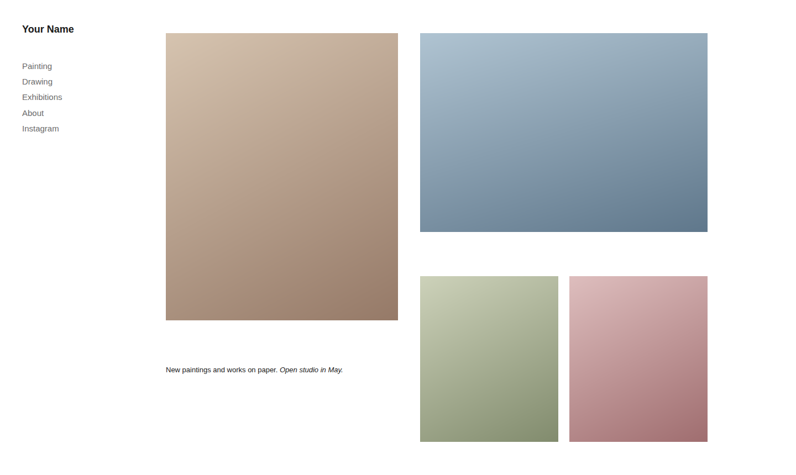
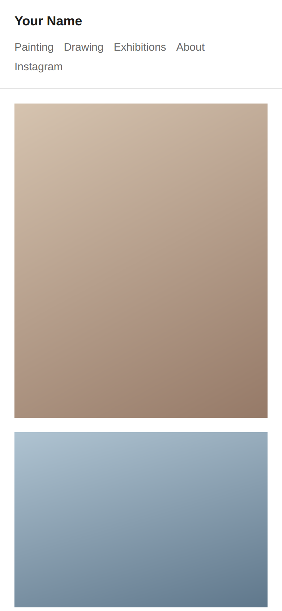
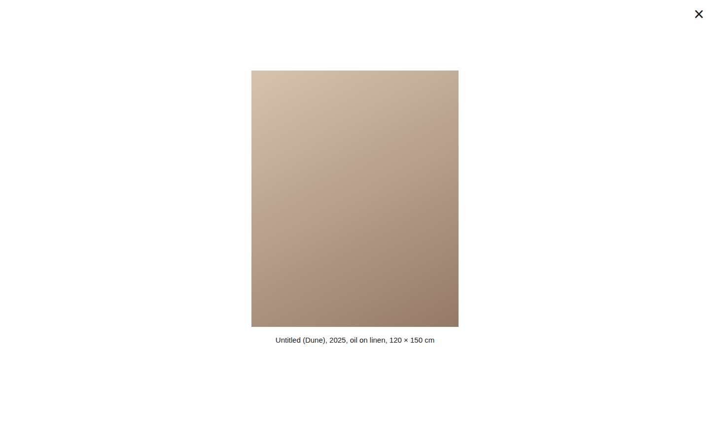
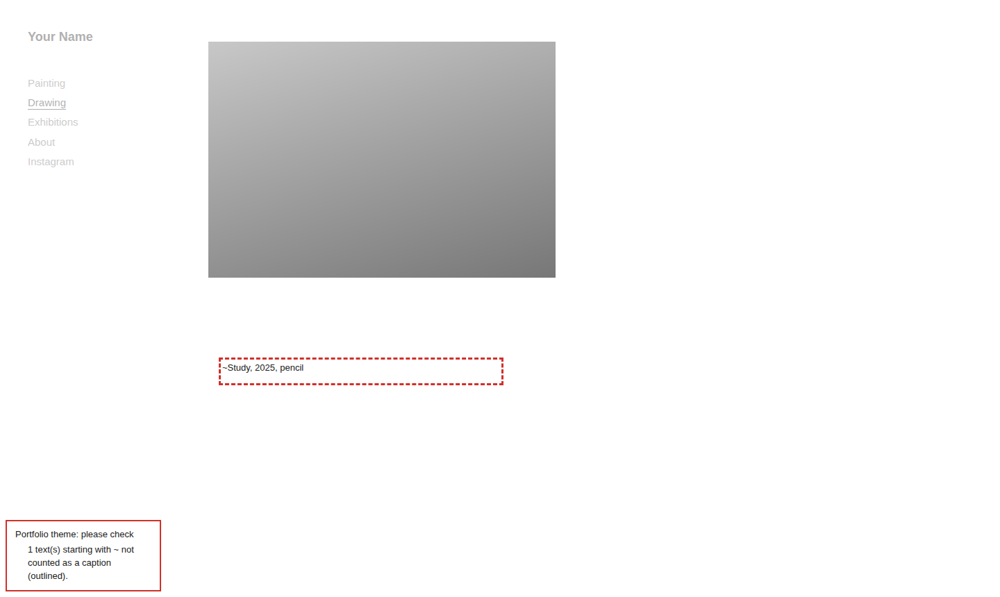

# hotglue portfolio theme

A paste-in theme that turns a [hotglue.me](https://hotglue.me) site into an artist's
portfolio. hotglue.me is a website builder where pages are made by hand: photos, text and
videos are dragged anywhere on an open canvas. The theme is two files (CSS and a small
script) that the site's owner pastes into hotglue's settings once. You don't need to know how
to code: you copy two files and change a few lines of text.

 

What it adds:

- your name and a menu on every page, with the current page highlighted;
- click a photo to see it on its own with its caption; arrow keys show the next one, and
  each photo gets a link you can share;
- pages made on a big screen shrink to fit smaller screens, so nobody has to scroll sideways;
- on phones, the menu on top and everything in one column;
- your own colours, font and menu width (black on white to start with; ready-made colour
  palettes included);
- while you edit, a red box that tells you if something won't work, for example an object
  hidden under the menu or a caption too far from its photo.

 

Free and open source. An independent project, not made by hotglue.me or connected to it.
Vibe-coded with [Claude Code](https://claude.com/claude-code), developed in
[Docker Sandboxes](https://www.docker.com/products/docker-sandboxes/).

## Install

You need a hotglue.me site and about ten minutes.

1. Open `https://<username>.hotglue.me/code` (your hotglue name instead of `<username>`;
   you need to be logged in). Use this address, not the code button in hotglue's editor:
   that button only changes one page.
2. Here on GitHub, click [`head.html`](head.html). Above the code, on the right, click the
   button **Copy raw file** (two overlapping squares).
3. On your /code page, click into the `<head>` box, select everything in it (Ctrl+A, on a Mac
   Cmd+A) and paste (Ctrl+V, on a Mac Cmd+V). Anything that was in the box is replaced.
   Check the end: the box must end with `</style>`.
4. Do the same with [`body.html`](body.html) and the `<body>` box. It must end with
   `</script>`.
5. In the `<body>` box, scroll down to the line `YOUR NAME AND MENU START HERE`. Under it,
   replace "Artist Name" with your name and the menu lines with your own pages, for example
   `Painting = painting` (the text to show, `=`, the page name from the page's address).
6. Click **save**, then open your site.

Optional: choose your colours, font and menu width under `YOUR SETTINGS` at the top of the
`<head>` box.

The manual is the note at the top of the `<body>` box, so you always have it with you. It
explains the menu, the three rules for building pages, updating, and what to do when
something looks wrong.

## Updating

Your version is on the second line of the `<body>` box. To update to the newest version:

1. Copy your name and menu lines, and your settings from the top of the `<head>` box, into a
   note on your computer.
2. Paste the new files into the boxes as in Install, steps 2 to 4.
3. Put your lines and settings back, and save.

## Good to know

- An enlarged photo is never shown bigger than you placed it in the editor, and only as sharp
  as that size (hotglue publishes photos at the size they are placed). Place photos large if
  they should look good on their own.
- Most laptop screens are 1280 pixels wide or more. To keep your page full size on them
  too, place your objects within about 1240 pixels of the left edge. Wider pages still
  work: they just shrink a little to fit.
- Shrinking to fit works in current browsers (Chrome, Edge, Safari, and Firefox from version
  126, 2024). Older browsers scroll sideways instead.
- Tested on computers and at phone sizes, in the engines of Chrome, Firefox and Safari; not
  yet on real phones.

## License

[MIT](LICENSE)
